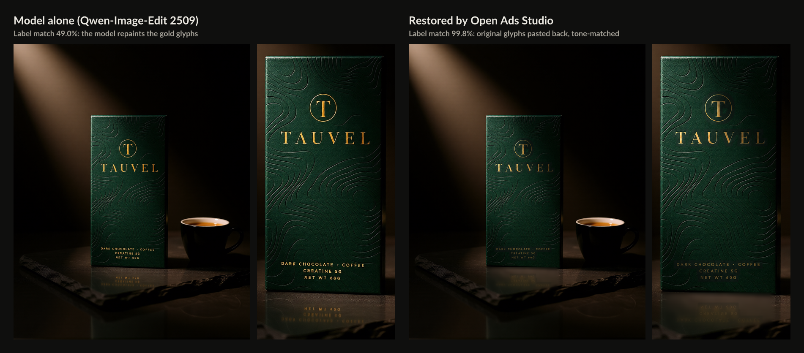
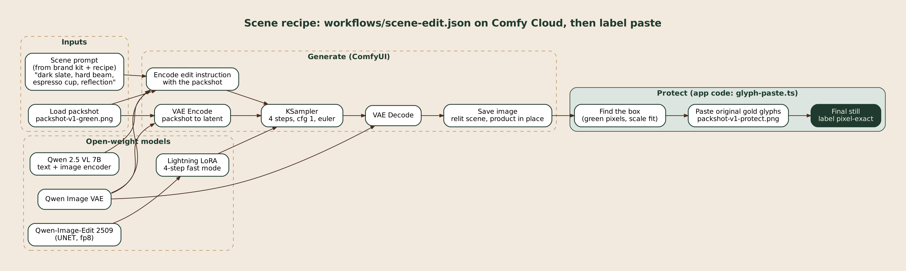

# Open Ads Studio

An open-weights rebuild of Higgsfield Ads Studio, built for Comfy's "Open Source Higgsfield" build night (#OpenSourceHiggsfield).

Product photo + brand kit in. Label-exact ad stills and short video with audio out. Every generation step is an open-weight model running as a ComfyUI workflow; the JSON for each one is in [`/workflows`](workflows).

**What makes it different:** AI ad tools garble packaging. Open Ads Studio never lets a model repaint the label. The model relights the real packshot in place, then its gold glyphs, a protected region, are found and pasted back tone-matched to the scene, and motion is keyframed from first and last frames.

**Live:** https://open-ads-studio.vercel.app (demo mode: example renders, auto-deployed from `main`).

> Status: in active development during the event. See [`docs/PLAYBOOK.md`](docs/PLAYBOOK.md) for the plan, milestones and decisions.

## How the label stays exact



1. **Protect mask.** The packshot ships with a mask of its gold glyphs (`assets/tauvel/packshot-v1-protect.png`): wordmark, monogram and small print. Those pixels are never taken from a model.
2. **The model owns the scene.** Qwen-Image-Edit 2509 gets the real packshot as its input image and relights it in place on the art-directed set (`workflows/scene-edit.json`). Light, shadow, surface and reflection are the model's; the label is not.
3. **Find the box.** The model reframes freely, so the app locates the pack in its output: green-pixel bounds for a first guess, then normalized cross-correlation on gradients to refine a separate X and Y scale plus shift.
4. **Paste tone-matched glyphs, reflection included.** The original glyphs are warped into place and scaled by the scene's local luminance (a float box blur of the model's own render), so the gold catches the new light. A vertically flipped copy goes into the reflection at 25% opacity, fading with depth.
5. **Per frame for video.** Cinemagraph clips run the same paste on every frame, with tone matching recomputed per frame, so moving light still lands on exact glyphs.
6. **Label-match score.** Each creative reports the SSIM structure term over the glyph mask, against the packshot, for the model alone and after the paste. On the example above: 49.0% before, 99.8% after. Review shows both numbers; video reports its worst frame.

The box detection and paste live in [`src/lib/server/glyph-paste.ts`](src/lib/server/glyph-paste.ts), the per-frame pass in [`clip-paste.ts`](src/lib/server/clip-paste.ts), the score in [`label-match.ts`](src/lib/server/label-match.ts). The figure is rebuilt with `npx tsx scripts/build-label-figure.ts`.



## How it works

| Recipe | Output | Models | Workflows |
|---|---|---|---|
| Scene | Hero still: the packshot relit in place on an art-directed set | Qwen-Image-Edit 2509 | `scene-edit.json` + glyph paste |
| Reveal (Draft) | The bar rises out of the sleeve, fast preview | LTX-2 19B distilled | `vfx-ltx-reveal.json` |
| Reveal (Final) | Same reveal with native audio | MiniMax H3-Base FL2VA | `hero-h3.json` |
| Cinemagraph | A Scene still comes alive: steam, light, room tone | MiniMax H3-Base FL2VA | `hero-h3.json` + per-frame glyph paste |

Deterministic steps (no model): copy-line templates and the claims guard, export layouts (9:16, 1:1, 16:9) with the logo, end card and AI-disclosure badge, box detection and the protected-glyph paste (tone-matched, plus its reflection), and post (`scripts/post-vfx.ts`: frame holds and an eased push-in, via ffmpeg).

Rule for every recipe: nothing occludes the protected label region. Effects stay behind or below the pack.

## Setup

Requirements: Node 22+, ffmpeg on your PATH (for the post step), and a Comfy Platform API key with credits.

```bash
git clone https://github.com/jhoard/open-ads-studio.git
cd open-ads-studio
npm install
cp .env.example .env      # then set COMFY_API_KEY
npm run dev               # http://localhost:3000
```

The key stays server-side. `.env` is loaded with override, so it beats any key in your shell.

`GENERATION_MODE=demo` serves the bundled example renders and never calls Comfy; it is the default on Vercel, so a public link cannot spend credits. Locally the default is `live`.

Tests: `npm test` (claims guard, export layouts, brand kit and DESIGN.md round trip).

### Brand from a URL

The Brand step runs the Design Extractor (vendored in `packages/design-extract`) on the site you paste: palette, typography, logo and hero images become the brand kit, and scene directions start from the palette (dark-dominant brands get Slate beam and Dark stone evening, light-dominant ones Linen ritual and Travertine morning). Locally it uses Playwright's Chromium (`npx playwright-core install chromium` once if you have none cached); on Vercel it uses `@sparticuz/chromium`. If a crawl fails or runs past 45 s, the cached Tauvel kit loads with a notice. Download DESIGN.md exports the kit in the Extractor's format with your tone, audience and scene-direction edits appended; Import DESIGN.md reads one back. The crawler only visits public http(s) sites; local and private addresses are refused.

Run recipes from the command line:

```bash
npx tsx scripts/run-relight.ts                                  # Scene still (relight in place + glyph paste)
npx tsx scripts/run-cinemagraph.ts <scene.png>                  # Cinemagraph from a finished Scene
npx tsx scripts/run-vfx.ts vfx-reveal 3:4 "<motion prompt>"     # Reveal, Draft (LTX-2)
npx tsx scripts/run-vfx.ts hero-h3 3:4 "<motion prompt>"        # Reveal, Final (H3)
npx tsx scripts/post-vfx.ts in.mp4 out.mp4                      # holds + push-in
```

Outputs land in `var/` (git-ignored).

### Backends

- **Comfy Cloud (default):** the app submits the API-format workflows in `/workflows` to `cloud.comfy.org` with the `@comfyorg/sdk` workflow client. All checkpoints are open weights hosted there; the workflows contain no API (partner) nodes.
- **Your own GPU:** run ComfyUI with [`comfy-api-proxy`](https://github.com/Comfy-Org/comfy-api-proxy) and set `COMFY_BASE_URL=http://127.0.0.1:8189`. The same workflow JSONs run unchanged. Model files and a Runpod template are documented in a later milestone (see the playbook).

## Workflows

| File | What it does |
|---|---|
| `workflows/cutout.json` | BiRefNet background removal |
| `workflows/scene-set.json` | Qwen-Image-Edit 2509 renders an art-directed set with no product in it |
| `workflows/scene-edit.json` | Qwen-Image-Edit 2509 edits a set at the same size (for example, adding the frozen wave) |
| `workflows/scene-composite.json` | Cutout, placement, contact and cast shadow, low-denoise harmonize, protected-glyph paste |
| `workflows/vfx-ltx-reveal.json` | LTX-2 first and last keyframe video with the protected paste on every frame |
| `workflows/hero-h3.json` | MiniMax H3 first and last keyframe video with native audio |
| `workflows/vfx-ltx.json` | LTX-2 single image to video (quick clip) |
| `workflows/scene.json` | Single-pass catalog still (superseded by the recipes) |

Several were converted from the official Comfy templates with `scripts/ui-to-api.ts`, which flattens UI-format workflows (including subgraphs) into the API format the SDK submits.

## Credits and licenses

Code in this repository: [Apache-2.0](LICENSE).

Models (weights are not included in this repo and keep their own licenses):

- [Qwen-Image-Edit 2509](https://huggingface.co/Qwen/Qwen-Image-Edit-2509), Apache-2.0, with the Qwen-Image-Edit Lightning LoRA
- [LTX-2](https://huggingface.co/Lightricks/LTX-2) by Lightricks, LTX-2 Community License
- [MiniMax H3](https://huggingface.co/MiniMaxAI/MiniMax-H3) H3-Base, MiniMax H3 Community License
- [BiRefNet](https://huggingface.co/ZhengPeng7/BiRefNet), MIT

Fonts in `assets/fonts` (Gilda Display, Lato) are under the SIL Open Font License 1.1; license files sit next to them.

Built on [ComfyUI](https://github.com/comfyanonymous/ComfyUI), [Comfy Cloud](https://cloud.comfy.org) and the [`@comfyorg/sdk`](https://github.com/Comfy-Org/comfy-typescript-sdk) (MIT).

Demo brand: Tauvel is the author's own brand. Input packshots made with GPT Image; all generation in the app is open weights.
