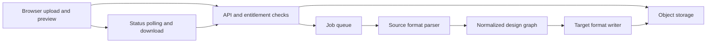

# Magicul public frontend investigation

Inspected October 29, 2026. Target: https://magicul.io/.

## Main finding

Magicul exposes a Next.js/React frontend that coordinates a separate conversion API. Its delivered code implements upload processing, file preview, payment or credit selection, conversion progress, and download presentation. The actual parsers and format writers were not recovered. A reconstruction can follow the observed client workflow, but equivalent conversion fidelity would require independently implementing the engine.

## Scope and evidence

This investigation inspected an isolated, unauthenticated Chrome page using the reverse-engineer-anything skill and REA. It also read public product, pricing, and feature pages. No files were submitted, accounts created, or payments initiated. API routes below are declarations and call sites in delivered JavaScript, not independently exercised API contracts.

Retained evidence is in [magicul-evidence.json](./magicul-evidence.json):

- E1: `ev_5ab73ffab0b8ce3c5c7f19dd8f975c7fe3e4964ba97ca8c1a4dc815ccec62e8f` — browser identity and selected homepage target.
- E2: `ev_5d026a33bc06d8f1b80d342e808866a3d5797fc8d7e6eeb4f967e6929c935536` — DOM, accessibility, same-origin resources, and captured JavaScript source.

E2 contains 72 script entries totaling 1,057,339 source bytes. The capture excludes some third-party resources, unattributed scripts, workers, and unsupported URLs. This count describes the captured homepage, not the entire application.

## Observed frontend structure

| Finding | Evidence and confidence |
| --- | --- |
| Next.js with Pages Router artifacts | E2: `/_next/static/chunks/pages/_app-73f4dfd5dea28da5.js`, `pages/index-c7da45af3702eff6.js`, build and SSG manifests. High-confidence framework identification. |
| React runtime | E2: framework bundle and React component/hook code. High confidence. |
| Webpack chunking | E2: `self.webpackChunk_N_E` registration and webpack runtime. Direct observation. |
| State-machine workflow | E2: named upload, preview/payment, and conversion states; supporting bundle includes XState identifiers. Direct code observation. |
| API service | E2: configured base URL `https://api.magicul.io`. Its infrastructure and server implementation remain unknown. |
| Chargebee checkout | E2: Chargebee script declaration, `Chargebee.getInstance()`, `openCheckout`, and hosted-page verification call sites. This does not establish a completed checkout. |
| Sentry error reporting | E2: Sentry browser package code, initialization, and service error-reporting call sites. Delivery and runtime reporting success were not tested. |
| Legacy product naming | E2: localStorage key declarations retain the `XD2SKETCH` prefix. This suggests product lineage; it does not prove its history. |

The API configuration and conversion route map live in the captured `_app` bundle. Main converter orchestration lives in `11653-a27ab5e0e72ff5c9.js`; checkout and storage helpers appear in `72317-a422b3b2596143b8.js`.

The route map declares 73 `/converter/...` paths, including XD, Figma, Sketch, PDF, Canva, PowerPoint, and whiteboard conversion routes. A declared route does not prove working support or conversion fidelity for that route.

## Recovered workflow

The following sequence comes from static client code. Only the initial page was observed running.

1. **Select source and destination.** The homepage exposes an upload panel and drag-and-drop affordance. Conversion identifiers use a `SOURCE_TO_TARGET` convention.
2. **Collect email and source.** The upload machine requires `userEmail` and checks whether the user exists. Local uploads use multipart form data with `email`, `file`, and `format`.
3. **Use source-specific import adapters.** Figma and FigJam imports submit JSON containing email, file, and format. Google Slides uses a presentation ID extracted from its URL. Canva uses the supplied URL.
4. **Process upload.** The client retains the returned file name and artboard count, then requests upload status. An unfinished response schedules another check after two seconds. The code distinguishes completed and failed processing.
5. **Show preview and determine entitlement.** The preview machine permits target changes. Lifetime, Annual, and Enterprise plan labels enter the credit-deduction service path. Logged-in users with available credits get a confirmation state. Other users select a payment type and open checkout. A free-conversion predicate exists, but its captured allowlist is empty.
6. **Verify checkout.** The client requests a Chargebee hosted page from its API, opens checkout, then asks its API to verify the hosted-page ID. Server authorization behavior is unknown.
7. **Request conversion.** The client posts JSON containing `fileName`, optional `hostedPageId`, `convertTo`, and `free`. The request includes credentials. The code also accepts optional `cliFlags` from the page query string; their server behavior was not investigated.
8. **Poll conversion.** A one-second interval requests conversion status. The client handles `Uploaded`, `InProgress`, `Done`, and `Failed`, and exposes progress for artboards/images.
9. **Retrieve results.** On completion the client fetches file details and presents the converted-file view. Retry and convert-another paths exist. The current file identifier and conversion type are saved to localStorage during the flow and cleared in the result view.

## API surface declared by the client

All routes in this table use `https://api.magicul.io`. Methods are included only where the inspected call sites establish them.

| Purpose | Route | Client evidence |
| --- | --- | --- |
| Local file upload | `/upload` | POST multipart: email, file, format; upload-progress callback |
| Remote import | `/upload/figma`, `/upload/figjam`, `/upload/google-slides`, `/upload/canva` | POST JSON with source-specific fields |
| Upload processing | `/upload/status` | GET with `fileName` query parameter |
| Conversion request | `/convert` | POST JSON; credentials included |
| Conversion progress | `/convert/status` | GET; repeated `fileName` query parameters supported by helper |
| File metadata | `/download/info`, `/download/infos` | Endpoint declarations and metadata-fetch helper use |
| Download presentation | `/download/{identifier}` | URL construction in captured file-list code; not exercised |
| Hosted checkout | `/payment/hosted-page` | POST; response supplies `hosted_page` |
| Payment verification | `/payment/verify` | GET with `hostedPageId` |
| Credit use | `/payment/use-credits` | Client credit-deduction service |
| Payment status | `/payment/status` | Endpoint declaration |
| Account | `/user/me`, `/user/login`, `/user/logout`, `/user/exists`, `/user/update` | Endpoint declarations; login URL includes callback |
| History and billing | `/user/files`, `/user/invoices`, `/user/invoices/{id}/pdf` | Endpoint declarations |
| Deletion | `/files/delete/by-source` | Endpoint declaration; not invoked |
| Figma token storage | `/user/auth/figma-access-token` | Endpoint declaration; not invoked |

The frontend also declares a separate repair service at `https://file-repair-service.herokuapp.com`, with upload, status, download-URL, and repair paths. Its availability and implementation were not tested. No API fuzzing or authorization probing was performed.

## Product promises and pricing

These are vendor statements, not independently verified conversion results:

- The [homepage](https://magicul.io/) markets conversion, browser-based inspection/editing, and scheduled Figma backups, including customer-owned S3 storage.
- The [XD-to-Figma page](https://magicul.io/converter/xd-to-figma) describes component, prototype-transition, text-style, color-style, image, and hierarchy preservation. Unsupported component overrides may fall back to shapes.
- The [feature overview](https://magicul.io/converter-features) explicitly acknowledges that format differences can prevent exact replication.
- The [pricing page](https://magicul.io/pricing) lists $94 per file up to 50 artboards, $124 with unlimited artboards, credit packs, a $499/year unlimited offer, and $2,895/month enterprise pricing. These were observed page values, not checkout quotes. Promotional end dates differ across public pages, so offer timing is unresolved.

## Reconstruction implications — proposed design

This is an implementation proposal based on the client evidence, not recovered server architecture:

A normalized graph could represent pages, frames, transforms, vector geometry, text runs, fonts, images, styles, components, instances, and prototype links. Per-format readers and writers could translate this representation, with explicit fallbacks when destination semantics differ. The graph, queue, storage layout, and worker isolation in this diagram are suggested engineering choices; none was observed inside Magicul's server.

The difficult reconstruction work is semantic conversion: font metrics, text shaping, transforms, clipping, effects, component overrides, and valid native output. A sensible first implementation would support one conversion pair and validate both appearance and editability against a small fixture corpus before adding formats. UI parity alone would not establish engine parity.

## Completion ledger and remaining gaps

| Investigation question | Status |
| --- | --- |
| What products and workflow does the public site expose? | Answered for the public pages and captured homepage. |
| What frontend technology is delivered? | Answered for captured same-origin bundles. |
| How does the client orchestrate upload, payment, and conversion? | Answered statically; end-to-end execution untested. |
| Which API routes and payloads are exposed? | Partially answered; declarations and selected call sites recovered. |
| How are file formats actually parsed and written? | Unresolved; server algorithms unavailable. |
| How accurate are conversions? | Unresolved; no input/output fixture conversion performed. |
| How are jobs, databases, storage, and authorization implemented? | Unresolved; proposed architecture only. |
| Do inspector and backup products share code or backend services? | Unresolved; public positioning does not establish implementation sharing. |

REA attachment cannot recover earlier network events. Source-map URLs were declared but maps were not fetched. Third-party resources and workers were excluded from the capture scope. Static code establishes intended client behavior, not successful API execution, payment enforcement, data retention, encryption, or production reliability.
