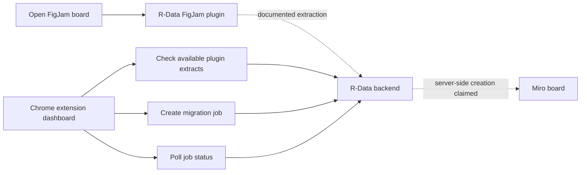

# R-Data investigation

Inspected October 29, 2026. Target: https://r-data.co/ and its publicly distributed Chrome extension, version 1.0.6.

## Finding relevant to FigJam → Miro

The shipped extension implements a workflow for FigJam-to-Miro migration. It recognizes board extracts supplied by the FigJam plugin, accepts Figma OAuth as an alternative, requires a Miro connection, creates migration jobs, starts extraction, and polls job status. This establishes client-side implementation beyond a marketing page. It does not establish that the backend currently completes migrations or preserves every object correctly.

The practical plugin route is:

1. Install the [Chrome extension](https://chromewebstore.google.com/detail/r-data-diagram-interop-fo/klpbkolgpcakhdgfodaiaokcconlgnkl) and [FigJam plugin](https://www.figma.com/community/plugin/1628073758890946314).
2. Use the same R-Data account in both.
3. Open the source FigJam board, run the plugin, and choose **Extract this board**.
4. In the extension, connect Miro, select the FigJam board, choose Miro, and start migration.
5. Validate a small board before a large migration: edit sticky text, move a connected shape, inspect dashed connectors, and check section/image handling.

Steps 1–4 follow the newer [store instructions](https://chromewebstore.google.com/detail/r-data-diagram-interop-fo/klpbkolgpcakhdgfodaiaokcconlgnkl) and inspected extension branches. They were not executed in this investigation. Step 5 is a proposed validation procedure.

## Evidence and artifact identity

- REA browser listing: `ev_9c3cd8f7d6827a32ded8b43958282c110e2e8a4c30b09a8697087ef8cc0e2562`.
- REA homepage inspection: `ev_2b452517a66e86c30a03b34625f794c95e8bf01345c4e91484b278cce5d25451`, retained in [rdata-evidence.json](./rdata-evidence.json).
- Direct static source ledger: [rdata-static-findings.json](./rdata-static-findings.json), containing file digests, character offsets, and focused excerpts. This is analyst evidence, not a successful REA application graph.
- Chrome extension ID: `klpbkolgpcakhdgfodaiaokcconlgnkl`.
- Downloaded CRX: 580,986 bytes; SHA-256 `a26e373040431892f6174771bd9eef56956881a4344343b57d4469abff7fe5a6`.
- Local package and extracted files are retained under `var/rdata/` (Git-ignored). The package was downloaded from Google's public extension update service. Its manifest reports version 1.0.6. Package signature verification was not independently performed.

REA captured the public homepage and its JavaScript successfully. Its subsequent static application analysis of the extracted extension ended with **Transport closed**; no application graph was returned. The extension findings below come from direct inspection of the downloaded source, with hashes and excerpts retained separately. The browser evidence does not authenticate the extension package.

## Recovered architecture

The public website delivers Next.js/React code, Turbopack chunks, and PostHog assets. The extension is a Manifest V3 application with a module service worker, popup, and separate dashboard. Its filenames include `dashboard-DTfSbOA4.js`, `globals-DjJcrUIf.js`, and `index.ts-CHCvJAR5.js`.

The extension API base is `https://r-data.co/api`. Its helper retrieves an R-Data session token from extension storage and adds a Bearer header. Registration, login, source connection, billing status, migration jobs, and downloads use that API.

Solid relationships are visible in extension orchestration, except the user opening the board. Dashed relationships depend on vendor documentation; plugin extraction internals and server-side Miro creation were not inspected.

## FigJam-specific code findings

| Finding | Observed source |
| --- | --- |
| Plugin extracts can substitute for Figma OAuth | Dashboard tests `!Pe.hasOAuth`, then queries available extracts for selected FigJam file keys. Missing extracts produce a message directing the user to the plugin. |
| Cached extract discovery | `getFigjamPluginExtracts` calls GET `/api/figjam/ingest?file_keys=...`. This read does not reveal the plugin's upload schema. |
| Miro connection is required | Dashboard checks `getMiroStatus()` and stops with a connection instruction if it is false. |
| Explicit source and destination | POST `/api/jobs/create` includes `type`, `source`, `target`, `document_count`, and selected document identifiers/titles. For this route: `type: "migrate"`, `source: "figjam"`, `target: "miro"`. |
| FigJam extraction coordination | Source dispatch calls POST `/api/figma/extract` with `{job_id, file_keys}`. The same client entry point is used after its plugin-extract/OAuth checks; backend selection logic is unknown. |
| Progress and recovery | Client polls `/api/jobs/{id}/status` and recognizes completed/partially-completed jobs. Other paths report extraction errors and pause state. |
| Optional preflight | POST `/api/analyze` accepts `{source, id, target}`. UI consumes shape counts, mapped/downgraded counts, fidelity, and skipped-drawing fields. These are estimates returned by the service, not measured fidelity in this investigation. |

The presence of a plugin-extract check is especially relevant after Magicul failed: R-Data offers an explicit way to supply source content from the open board. It does not merely accept a public URL. That design may avoid access problems associated with fetching an unauthenticated board, but this has not been tested on the user's board.

## Advertised coverage versus verified behavior

The [store listing](https://chromewebstore.google.com/detail/r-data-diagram-interop-fo/klpbkolgpcakhdgfodaiaokcconlgnkl) claims transfer of sections, shapes, stickies, connectors, images, and pen strokes. It lists limitations including rich text simplification and omission of collaboration comments and version history. These are vendor statements, not fixture results.

The [shape catalog](https://r-data.co/shapes) lists 29 FigJam shape mappings. The [guide](https://r-data.co/guide) labels FigJam-to-Miro beta. Neither proves exact visual or semantic round-trip fidelity. The plugin source, FigJam normalization logic, and Miro writer were not recovered from the inspected extension modules.

## Documentation discrepancies

1. **Plugin requirement:** the guide's setup section says the plugin is unnecessary for FigJam-to-Miro; the newer store listing and extension message explicitly describe plugin-based extraction. The extension also retains OAuth as an alternative. For the plugin route, follow the store workflow and actual extension UI.
2. **Permissions:** the privacy page's host list omits PostHog, while the shipped manifest includes `https://us.i.posthog.com/*`. Direct extension source initializes PostHog with automatic capture and session recording disabled; the public website separately delivers recording assets. Asset presence does not establish that any particular recording occurred.
3. **Data flow:** privacy text describes the plugin as a receiver and says it sends no canvas data back; newer store instructions describe plugin extraction as well. Consequently the policy does not clearly explain the newer source-plugin flow. The policy states server retention of document data for seven days and metadata for thirty days; retention was not verified. [Privacy policy](https://r-data.co/privacy).

## What can be reconstructed from this inspection

The extension exposes account handling, connection checks, migration job payloads, progress handling, a Lucid extraction implementation, and a structured document representation with pages, shapes, and connectors. It does not expose the full FigJam-to-Miro engine. Reimplementing that route would still require a FigJam plugin reader and a Miro writer, including object-type mappings, coordinate conversion, text handling, and connector endpoint association.

## Completion ledger

| Question | Result |
| --- | --- |
| Is FigJam-to-Miro represented in shipped client code? | Answered: yes, orchestration and source-access checks. |
| Is there an alternative to public-link import? | Answered: plugin-provided extracts and Figma OAuth branches exist. |
| What API payload starts migration? | Answered statically for job creation/extraction coordination. |
| What permissions does the extension request? | Answered from manifest; no extension was installed. |
| Does it successfully migrate this user's board? | Unresolved; no authenticated migration run. |
| Are objects editable and connectors attached after migration? | Unresolved; vendor claims require a fixture test. |
| What exactly does the FigJam plugin serialize and how does the server create Miro items? | Unresolved; those implementations were not inspected. |

No account was created, extension installed, plugin run, source document accessed, payment initiated, or migration executed. Captured JavaScript and static branches establish delivered code and intended behavior, not successful execution or server enforcement.
